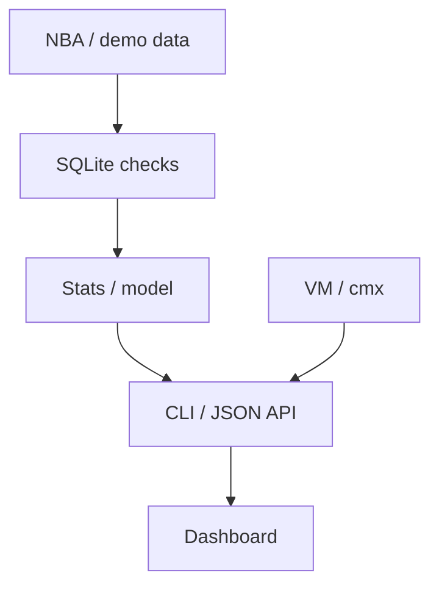

# SPORTSSTATS

* Sydel Ugwu 
* COMP 388 
* Midterm progress report 
* October 15, 2026

**Cloud choices:** Multipass, Jetstream2 (OpenStack), and Amazon (AWS).

## Summary

SPORTSSTATS is Sydel Ugwu's solo project for exploring basketball scores and comparing predictions. Users can choose a team and a points target, then see how often that team passed the target. The project uses Python and SQLite, with a terminal interface, a JSON API, and a web dashboard.

The current version uses real NBA team scores from the 2014–15 regular season. It also includes a small logistic regression model that learns from earlier games. For Chicago, the model did slightly better than a forecast based on the team's past results, but a simple 50% forecast had the lowest error. That result is part of the project, even though the model did not come out ahead.

On October 15, the application passed 34 tests on the Mac and 34 tests on an Ubuntu AWS instance. The historical dashboard also opened from AWS through an SSH tunnel. The sections below explain those results, the three cloud choices, and the evidence still needed for the full cloud setup.

## Project Goal and Research Question

The goal is to make basketball statistics easier to explore and check whether a small model can improve on simple predictions. An average score gives some information, but it does not show how often a team passed a particular target.

**Research question:** For Chicago's 2014–15 regular season, does a logistic regression model using earlier games predict scoring above 100.5 points more accurately than a historical-rate forecast or a constant 50% forecast?

The current project covers team scores, data import, probability estimates, model comparisons, and the dashboard. The earlier demo uses fictional player records to test player and opponent filters. The real dataset contains team totals. Real player data, more seasons, and live NBA data are planned for later. The project does not offer guaranteed predictions or real-money betting.

## Data and Application Design

The historical data comes from FiveThirtyEight and is available under CC BY 4.0. The selected season has 1,230 games and 30 teams. Each game has a row for each team, giving 2,460 team-game rows. FiveThirtyEight credits Basketball-Reference for the original game information.

The importer downloads a fixed source version and checks its SHA-256 checksum before using it. This helps keep repeated runs on the same data. SQLite checks for duplicate records and inconsistent scores. Replacing an existing dataset requires an explicit option. Raw downloads, databases, VM disks, and credentials stay out of Git.



The terminal and dashboard use the same analysis code. The dashboard gives users a way to explore the results visually, while the CLI and API allow the same analysis to run without it.

## AI Model and Evaluation

The model predicts whether Chicago scores strictly more than 100.5 points. It uses the previous game's score and the average score from the five earlier games. Both inputs are measured relative to the target and divided by 20. The model also includes an intercept.

Weights start at zero, and the learning rate is 0.05. Training begins after five earlier games. Scoring begins after ten earlier games, leaving 72 games for comparison. The model predicts each date's games before learning from that date's results. This prevents a game's outcome, or another outcome from the same date, from entering its prediction.

All three forecasts use the same 72 evaluation games. The historical forecast uses earlier results with smoothing, while the constant forecast always predicts 50%. The settings were fixed before this reported experiment. This is an early check on one team and one season, rather than a broad test of NBA prediction accuracy.

## Results

| Chicago 2014–15 regular season | Result |
| --- | --- |
| Games in the historical summary | 82 |
| Games above 100.5 points | 43 |
| Average team points | 100.79 |
| Historical rate above the target | 52.44% |
| 95% Wilson interval for that rate | 41.76%–62.90% |
| Games used to compare all three forecasts | 72 |
| Logistic model Brier score | 0.2533 |
| Historical-rate Brier score | 0.2572 |
| Constant 50% Brier score | 0.2500 |

Brier score measures the average squared difference between a predicted probability and the result, recorded as zero or one. A lower score is better. Always predicting 50% gives a score of 0.2500, which beat the model's 0.2533 in this experiment.

The model's small improvement over the historical forecast does not show that it will work better on other teams or seasons. The Wilson interval describes uncertainty in the historical rate under an independent-game assumption. Games within a season can influence one another, which limits that interpretation. The interval does not guarantee what will happen in the next game.

The dashboard also has an older historical-only comparison that skips five games and scores 77. The separate model panel uses the correct shared group of 72 games for the three-way comparison.

## Cloud Computing and `cmx vm`

The project uses three cloud categories required by the assignment:

| Cloud | Purpose | Recorded progress |
| --- | --- | --- |
| Multipass | Local development and deployment | October 1 evidence shows the earlier fictional-data app and service recovery after a restart. A recorded result is still needed for the updated historical app through cmx. |
| Jetstream2 | OpenStack deployment of the same application | Week 3 evidence shows an Ubuntu 24.04 VM and SSH access. Week 4 includes OpenStack management commands. The saved record still needs the current SPORTSSTATS application and cmx results. |
| Amazon (AWS) | Public-cloud run on Ubuntu | October 15 screenshots show SSH access, source transfer, 34 passing guest tests, a completed model command, and a working historical dashboard. Live cmx operation is a separate check. |

The EC2 instance is named `SPORTSSTATS`. It was launched in the AWS console and set up through SSH. This shows that the application runs on AWS, while full automatic VM provisioning through cmx still needs its own evidence.

The application's cmx adapter currently prints plans for Multipass and AWS:

```bash
python3 -m sports.cloud plan --cloud multipass
python3 -m sports.cloud plan --cloud aws
```

These commands print plans. They do not launch VMs. The printed AWS `start` command creates a new VM, so it should not be used to connect to the instance already running in the console.

Once the source and historical database are installed in `~/sports-project`, this command checks the guest analysis through cmx:

```bash
python3 -m sports.cloud smoke --cloud aws --name SPORTSSTATS
```

The check looks for a success marker, data rows, and evaluated games in the output. A command returning without an error is not enough by itself. The reviewed upstream AWS provider has driver setup and method problems that remain separate from the working SSH deployment.

The integration was checked against `dev2` at `f55d7bd`. Jetstream2 uses OpenStack, and the repository already contains [Week 4 Jetstream2 management commands](assignments/week4/jetstream/Makefile) and [Week 3 VM evidence](assignments/week3/vms.md). The existing Chameleon option in the application helper comes from earlier coursework; a Jetstream2-specific cmx profile still needs configuration and recorded validation. [AWS setup](project/aws-setup.md) and [AWS evidence](project/evidence/aws-oct15.md) give more detail.

## DevOps

Make targets group the common test, import, model, and server commands. Automated tests check data handling, model timing, and agreement between the CLI and API. Git commits keep the data, model, interface, cloud, and documentation work in smaller pieces.

The existing Multipass deployment script creates a dedicated Ubuntu 24.04 VM, transfers source, runs tests, and sets up a systemd service. The database stays on the guest disk. The earlier service restart was checked on October 1.

An [installer for existing Ubuntu VMs](project/existing-vm-setup.md) is also prepared. It runs tests, imports missing historical data, and creates a separate service on guest port 8765. Shell and service-file checks passed in preparation. A live installation with this new script has not been recorded. It leaves the instructor's cmx code alone.

## Testing and Evidence

- [Preparation checks](project/evidence/oct15-verification.txt): 34 passing application tests, including model timing and HTTP checks. These ran without a real cloud account.
- [Mac checks](project/evidence/mac-oct15.md): the October 15, 8:30 am screenshot shows 34 tests and `OK`. Later AWS-plan changes passed in preparation and need a recorded Mac rerun.
- [AWS checks](project/evidence/aws-oct15.md): the 2:20 pm screenshot shows 34 tests in 1.719 seconds and `OK`. At 2:28 pm, the dashboard showed Chicago's 43 of 82 games above the target, a 52.4% rate, and a 100.8-point average. The lower 72-game model panel was outside that screenshot.
- [Saved experiment results](project/evidence/nba2015-summary.json): exact scores, model settings, source revision, and checksum.
- [Earlier VM checks](evidence/vm-deployment.md): October 1 screenshots show 23 guest tests for the older app and a healthy service with 144 fictional-data rows after restart. This is evidence for that earlier version, rather than the new historical model or a byte-for-byte database comparison.

## Running the Project

From the repository root, with Python 3.12 or newer:

```bash
make -C sports test
make -C sports history
make -C sports model
make -C sports historical-serve
```

The local dashboard opens at <http://127.0.0.1:8000>. It starts with Chicago and a 100.5-point target. The working AWS tunnel used Mac port 8001, so that dashboard opens at <http://127.0.0.1:8001> while the guest server and tunnel stay open.

The historical import downloads about 18 MB into the ignored `sports/data/` folder. Skip `history` if the historical database already exists. The fictional demo has a separate database. More commands are in [the run instructions](sports/README.md).

## Class Contributions and Instructor Feedback

- **Key scanner:** two files, with 81 additions and one deletion, mostly tests. The fix changes one command so the scanner checks for an empty passphrase without prompting. Two tests using temporary real keys pass. The terminal regression test fails on unchanged dev2.

Neither fix has been published. The key-scanner patch has not been applied to the student's installed instructor code. Before a PR is submitted, its branch needs a fresh upstream check and focused tests. Each fix will stay separate, with documentation handled separately. [The contribution summary](project/contributions.md) explains the changes and the instructor's feedback.

## Student Work and Review

Sydel chose the existing sports topic and selected AWS as the public cloud. The student set up the EC2 instance and SSH key, transferred the source, ran the guest tests and model command, and opened the dashboard through an SSH tunnel.

Review of the current code is finished for now. Sydel also reports completing the remaining cloud and SSH-key checks. The available record does not yet include the final outputs from those checks. New cloud results should be recorded, while detailed key output should stay in a private local file.

## Issues and Remaining Work

1. **Cloud results and automation:** the saved evidence still needs the updated Multipass and Jetstream2 application runs, matched results across all three clouds, and actual cmx operations. AWS console setup and SSH access do not by themselves demonstrate fully automatic VM provisioning.
2. **Key-check records:** the last recorded scan incorrectly labeled a protected key as unprotected. The GitHub list also failed because `gh` was missing, followed by a misleading "No keys found" message. The final successful outputs need to be available privately for the instructor's check.
3. **Approval:** formal project approval and acceptance of the chosen clouds are not documented in the reviewed course record. The choices fit the required local, OpenStack, and public-cloud categories.
4. **Costs and cleanup:** AWS billing alarms have not been shown in the available evidence. The course requires them even with credits. The assignment asks students to keep Jetstream usage low to preserve class hours. Use the smallest suitable VM and shelve or delete it when idle; stopping alone is not enough.
5. **Further testing:** the full live AWS model panel, updated service recovery, and broader model evaluation need recorded results. More seasons and teams would help test whether the findings hold beyond this Chicago example.

Live NBA data and real player observations will be added later. Today's historical-data demo uses the completed 2014–15 season.

## Costs and AI Acknowledgment

The application uses no paid sports-data service or hosted LLM API. Multipass uses local resources, and Jetstream2 needs an eligible allocation. The AWS account showed a Free plan, $100 in credits, and 183 days remaining at 8:48 am on October 15. That was the morning balance, not a current bill.

The Ohio t3.micro launch screen showed a compute rate of $0.0104 per hour. Fifteen minutes at that rate is $0.0026 before disk, public IP, transfer, and other charges. Actual charges have not been checked. [The cost appendix](project/costs.md) covers these limits and free or open alternatives.

OpenAI was used in the process of formatting the NBA stats. The exact model name was not shown in the session. Sydel is responsible for reviewing the work and explaining the results and limitations. [The AI-use document](project/ai-usage.md) gives more detail about the assistance and checks.

## References

- [Week 7 assignments](https://cloudmesh-ai.github.io/cloudmesh-ai-lecture/lecture/assignments/assignments/) and [project requirements](https://cloudmesh-ai.github.io/cloudmesh-ai-lecture/lecture/assignments/overview/).
- Piazza: [third person #49](https://piazza.com/class/mt5rkdsycb31c3/post/49), [existing project and AI #88](https://piazza.com/class/mt5rkdsycb31c3/post/88), [acknowledgment #100](https://piazza.com/class/mt5rkdsycb31c3/post/100), [cost appendix #101](https://piazza.com/class/mt5rkdsycb31c3/post/101), [report format #102](https://piazza.com/class/mt5rkdsycb31c3/post/102), [AI-use presentation #111](https://piazza.com/class/mt5rkdsycb31c3/post/111), and [key checks #124](https://piazza.com/class/mt5rkdsycb31c3/post/124).
- FiveThirtyEight: [NBA source description](https://github.com/fivethirtyeight/data/tree/master/nba-elo) and [CC BY 4.0 data license](https://github.com/fivethirtyeight/data#license).
