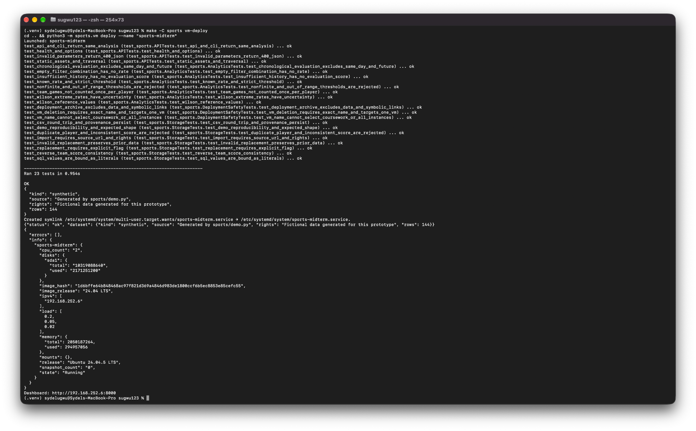
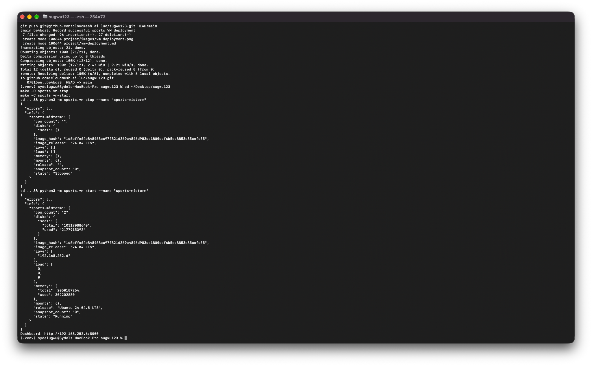
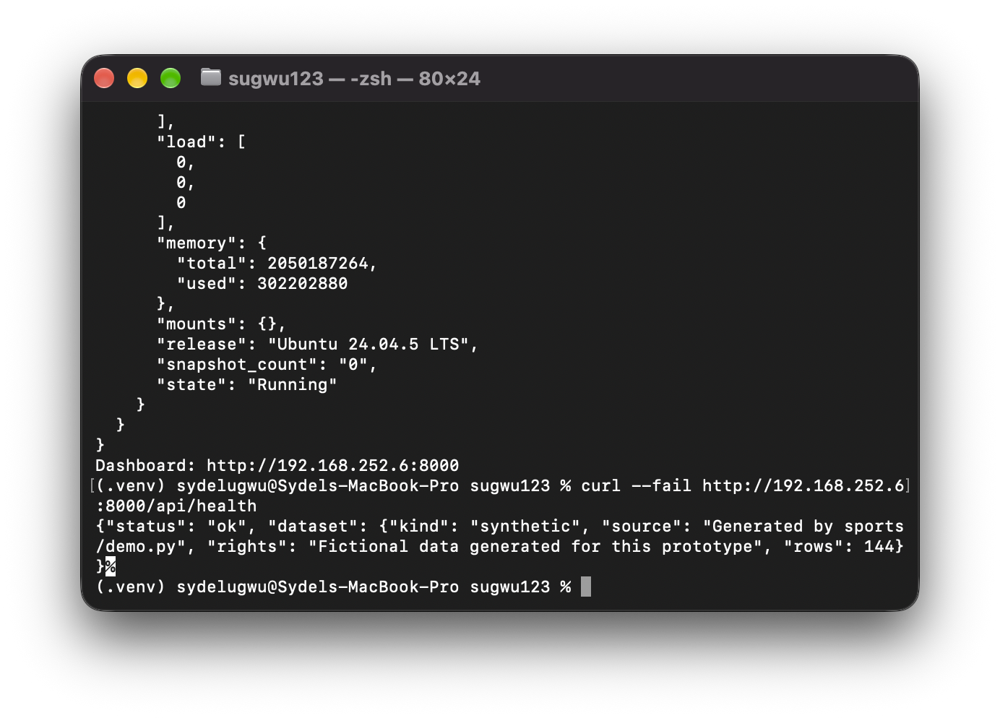

# Sports VM Deployment Verification

The sports application deployment and service recovery were observed on the Mac on October 1, 2026. The original terminal screenshots below are the evidence. Their results describe the earlier synthetic-data application, not the new October 15 historical model.

## Deployment

```bash
make -C sports vm-deploy
```

| Check | Observed screenshot result |
| --- | --- |
| Dedicated project VM | sports-midterm launched |
| Guest tests at that time | 23 tests; OK |
| Dataset | Synthetic, generated by sports/demo.py; 144 observations |
| Service | sports-midterm.service enabled; health status ok |
| Guest OS | Ubuntu 24.04.5 LTS |
| Resources | 2 CPUs, approximately 2 GiB RAM, 10 GB disk |
| Address at that time | http://192.168.252.6:8000 |



The address may change. `make -C sports vm-status` reports the current address.

## Stop, Start, and Host Health After Recovery



The original output shows `sports-midterm` stopped and then returned to Running after a native Multipass start.



The post-restart host request returns `status: ok` and 144 synthetic rows. This establishes service recovery and the retained observation count. It does not establish byte-for-byte identity of all database contents or a comparison of every prior analysis result.

## Current Verification Boundary

The earlier October 15 build passed 34 tests on the Mac, as recorded in [Mac evidence](evidence/mac-oct15.md). The later AWS-plan update passed 34 tests in the preparation environment; its Mac check remains open. Neither result proves that the historical model runs on this VM. The current VM automation still seeds/serves the default synthetic database. Importing the historical data, switching the deployed service, checking the updated dashboard, and reproducing the model on this VM remain open. Native Multipass evidence does not prove current cmx or remote-cloud behavior.

Acknowledgment: Original Mac screenshots provide the observed evidence. OpenAI Codex interpreted them and drafted this report; unobserved actions are not marked complete. See [AI usage](ai-usage.md).
