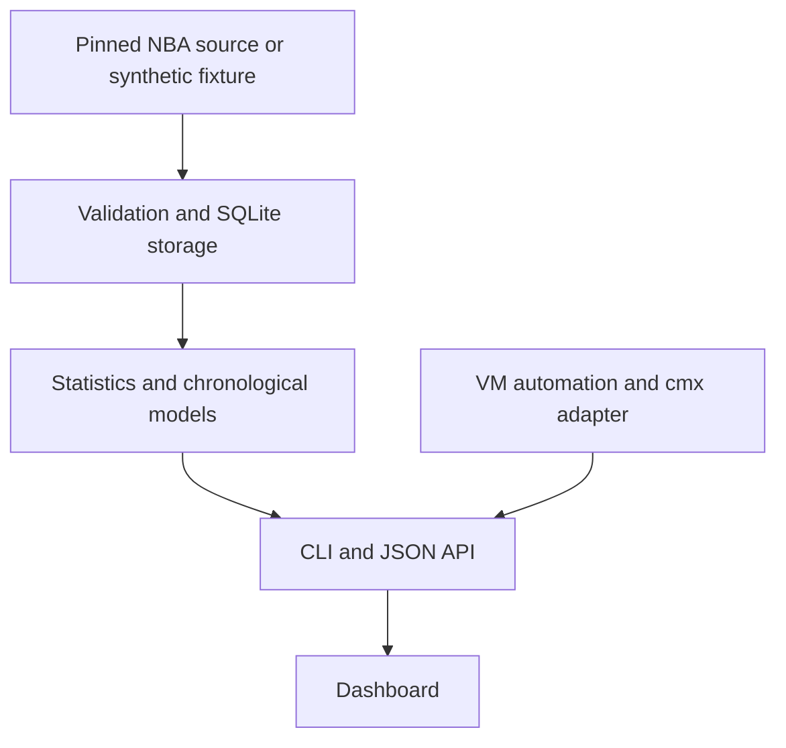

# SPORTSSTATS

Sydel Ugwu · COMP 388 · Solo project · Midterm progress report · October 15, 2026

**Cloud choices:** Multipass (local), Chameleon KVM@TACC (OpenStack), and **Amazon EC2 / AWS (public cloud)**.

## Executive Summary

SPORTSSTATS stores basketball results, shows how often a team passed a points threshold, and compares probability forecasts. The application uses Python, SQLite, a command-line interface, a JSON API, and a dashboard. The same analysis is available in the terminal and the dashboard.

The current milestone adds permitted historical NBA team data to the earlier fictional player demonstration. A pinned FiveThirtyEight dataset supplies 2,460 team-game observations from the 2014–15 regular season, representing 1,230 games and 30 teams. A small online logistic model uses only earlier game results. In the selected Chicago experiment, the model's Brier score is 0.2533 across 72 evaluated games, compared with 0.2572 for a historical-rate baseline and 0.2500 for a constant 50% forecast. The model does not beat the constant forecast on this sample.

October 1 screenshots show the earlier Multipass deployment and service recovery. On October 15, the application passed 34 tests on the student's Mac and 34 tests on the Ubuntu EC2 instance. The historical NBA dashboard opened successfully from AWS through an SSH tunnel. Its Chicago summary matched the prepared results. The selected clouds are Multipass, Chameleon KVM@TACC, and Amazon EC2. The updated historical application still needs live Multipass and Chameleon checks, full cmx verification, and completion of the instructor's SSH-key checks.

## Problem, Research Question, and Scope

Sports averages alone do not explain how often a points threshold was exceeded or whether a forecast improves on a simple baseline. The application preserves data provenance and exposes sample size, uncertainty, and chronological error.

**Research question:** For Chicago's 2014–15 regular season, does a logistic model using prior scoring history improve Brier error for the event `team points > 100.5`, compared with a smoothed historical rate and a constant 50% forecast on the same games?

The completed milestone covers team scoring, validated storage, reproducible import, historical summaries, model evaluation, CLI/API access, and a dashboard. The earlier synthetic dataset also exercises player and opponent filters. The historical source contains team totals, so aggregate records are explicitly labeled and are not presented as individual player statistics. Real player data, additional seasons, live feeds, and a larger cross-cloud experiment remain future work. Real-money betting and guaranteed predictions are outside the scope.

## Method and Architecture



The importer checks the source SHA-256 before conversion, selects the NBA regular season ending in 2015, and preserves both teams' views of each game. SQLite validation rejects duplicate observations and inconsistent scores. Existing data requires an explicit replacement flag. Raw CSV files, databases, credentials, and VM disks stay outside Git.

The historical frequency uses all 82 selected Chicago games. Its 95% Wilson interval describes sampling uncertainty under the binomial approximation; season dependence and selection bias limit that interpretation. It is not a confidence guarantee for an individual future game.

The logistic model has an intercept and two fixed-scale features: the prior five-game scoring mean minus the threshold, and the previous game's points minus the threshold, each divided by 20. Weights begin at zero. Learning starts after five earlier games, with learning rate 0.05. Evaluation starts after ten earlier games. Each date is predicted before its outcomes update the weights; same-day outcomes cannot enter same-day predictions. All three comparison scores use the same 72 evaluation games. Filters, threshold, and model settings were fixed before this reported experiment; the result is exploratory, not a tuned test of general NBA forecasting performance.

## Cloud Computing, DevOps, and AI

**Cloud computing:** The existing `sports.vm` automation creates a dedicated Ubuntu 24.04 Multipass VM, transfers source, runs guest tests, and configures a systemd service. SQLite remains on the guest disk. Native Multipass automation has observed evidence; the new three-provider `cmx` adapter has local contract tests, without a claim of live success on all providers.

**DevOps:** The repository contains Make targets, deterministic fixtures, transactional imports, unit and HTTP integration tests, service configuration, and versioned aggregate results. Focused commits separate data import, modeling, interfaces, cloud integration, and reporting. Deployment archives exclude data and symbolic links. Reproduction downloads the pinned source instead of putting raw data in Git.

An [existing-VM installer](project/existing-vm-setup.md) is prepared for the same historical application on Ubuntu guests. It runs tests, imports missing data, and configures a separate service on guest port 8765. It has passed shell and service-file checks in preparation, but has not been run on a live guest. It does not create VMs or change the instructor's cmx code.

**AI:** The application implements a small online logistic classifier using Python's standard library. Its predictions are tested against two baselines. No paid LLM API is called by the application. AI assistance in development and writing is disclosed separately in [AI usage](project/ai-usage.md).

### Three Clouds and Concrete `cmx vm` Integration

| Target | Project role | Implemented integration | Observed live evidence |
| --- | --- | --- | --- |
| Multipass | Local development and repeatable demo | Existing native deployment; new `cmx` plan and guest-analysis smoke command | October 1 synthetic app deployment and recovery; updated historical model through `cmx` still unverified |
| Chameleon KVM@TACC | OpenStack reproduction of the same source and dataset | `--cloud chameleon` plan and guest-analysis smoke command | Week 3 screenshot shows an earlier Ubuntu VM and SSH session; current allocation and SPORTSSTATS deployment/model run remain unverified |
| Amazon EC2 (AWS) | Short CPU evaluation on a public cloud | `--cloud aws` plan and guest-analysis smoke command; EC2 Name tag `SPORTSSTATS` | Running Ubuntu VM, SSH login, source transfer, 34 passing guest tests, historical model command, and working dashboard observed October 15; live cmx operation remains unverified |

The selection satisfies the required categories on paper. Instructor acceptance of the selection and actual three-cloud operation have not been established. Current integration targets upstream `dev2` at `f55d7bd`; Chameleon's native path also requires checking the instructor's current feature branch and smoke tests. The instructor's [latest Chameleon note](https://piazza.com/class/mt5rkdsycb31c3/post/126) uses `--security-group` and `--ssh-key`, with values taken from the actual allocation/configuration.

```bash
python3 -m sports.cloud plan --cloud multipass
python3 -m sports.cloud plan --cloud chameleon
python3 -m sports.cloud plan --cloud aws
```

These commands only print a plan. The AWS plan prints `cmx vm --cloud aws start SPORTSSTATS`. This creates a new VM; it must not be run to connect to a VM already created in the AWS console. The audited AWS provider still has driver initialization and method issues, so this plan is not proof that cmx works on AWS. After source and the historical database have actually been installed in `~/sports-project` on a target, the adapter can check a real guest analysis:

```bash
python3 -m sports.cloud smoke --cloud aws --name SPORTSSTATS
```

The smoke command requires a JSON success marker, data rows, and evaluated games. Error text or a zero exit code alone cannot pass. Source and historical data were installed on EC2, and the application ran successfully there. Chameleon application setup and live cmx verification remain open. The EC2 instance was launched in the console and configured through SSH, so full VM provisioning automation has not been established. [AWS setup](project/aws-setup.md) and [AWS evidence](project/evidence/aws-oct15.md) record the observed results. Existing local VM names and the Python package `sports` stay unchanged.

## Results and Verification

| Chicago 2014–15 regular-season result | Value |
| --- | --- |
| Selected games | 82 |
| Games strictly above 100.5 points | 43 |
| Mean team points | 100.79 |
| Historical frequency | 52.44% |
| 95% Wilson interval | 41.76%–62.90% |
| Matched chronological evaluation games | 72 |
| Logistic Brier score | 0.2533 |
| Historical-rate Brier score | 0.2572 |
| Constant 50% Brier score | 0.2500 |

Brier score is mean squared probability error; lower is better. Logistic regression slightly improves on the historical-rate baseline here, but the constant forecast has the lowest error. One team, one season, and one threshold do not establish an advantage on other data. No improvement claim is made from the synthetic demonstration. The dashboard's original historical-only panel uses a five-game warmup; comparisons with the logistic model must use the separate matched-cohort model panel, not that older panel's 77-game score.

Evidence is separated by environment:

- [October 15 verification](project/evidence/oct15-verification.txt): 34 passing local unit/HTTP tests in the preparation environment, including leakage and interface checks. No real cloud account was used.
- [October 15 Mac evidence](project/evidence/mac-oct15.md): the accessible 8:30 am screenshot shows `make -C sports test`, 34 tests, and `OK`. The later AWS-plan change passed 34 tests in the preparation environment and still needs to be checked on the Mac.
- [October 15 AWS evidence](project/evidence/aws-oct15.md): the 2:20 pm screenshot shows 34 tests in 1.719 seconds and `OK` inside `/home/ubuntu/sports-project`. At 2:28 pm, the dashboard opened through the SSH tunnel and showed Chicago's 43 of 82 games above 100.5 points, 52.4% historical rate, and 100.8 average points. The lower 72-game comparison was outside that screenshot.
- [Aggregate experiment](project/evidence/nba2015-summary.json): exact unrounded metrics, selection, model settings, source revision, and checksum.
- [October 1 VM evidence](project/vm-deployment.md): original Mac screenshots showing 23 guest tests at that time, systemd health, stop/start, and a healthy service with 144 synthetic rows after restart. This does not prove that all database contents were byte-for-byte unchanged or that the updated model was deployed there.

## Reproduce the Current Application

From the repository root, using Python 3.12 or newer:

```bash
make -C sports test
make -C sports history
make -C sports model
make -C sports historical-serve
```

Open <http://127.0.0.1:8000>. The real-data dashboard initially selects Chicago and threshold 100.5. The import downloads approximately 18 MB into ignored `sports/data/`. Skip `history` when the historical database already exists; replacement requires an explicit decision. The synthetic demo uses a separate database. [Run instructions](sports/README.md) describe both paths.

## Class Contributions and Review Feedback

[Upstream PR #11](https://github.com/cloudmesh-ai/cloudmesh-ai-vm/pull/11) is closed and unmerged. It changed 23 files with 1,224 additions and 378 deletions. The instructor requested a current upstream base, preservation of existing tests, reuse of hostlist utilities, validation before submission, one provider per PR, separate documentation, and one PR at a time.

A prepared successor changes only Google driver initialization and its tests. Seven focused tests pass without contacting Google. The four-file patch has 63 additions and 18 deletions, with existing test coverage preserved. It is separate from the SPORTSSTATS deployment, which now selects AWS. A wider provider test run still has an AWS failure that also occurs on unchanged dev2.

The October 15 key check also exposed an upstream scanner problem: it asks for an encrypted key's passphrase and can then incorrectly report that the key is unprotected. A separate one-line fix and two real-key regression tests were prepared in an isolated branch. The terminal regression test fails on unchanged dev2 and both tests pass with the fix. This two-file patch has 81 additions and one deletion, mostly tests. It remains unpublished and has not been applied to the student's installed instructor code.

No new upstream PR has been published. Each candidate stays separate; at most one will be submitted after student review, a fresh upstream check, and validation. The tested base is `dev2` at `f55d7bd`, as required by the current Week 7 assignment. [Contribution details](project/contributions.md) map the instructor's requests to the work.

### Student Work and Review

Sydel chose the existing sports topic, selected AWS, set up the EC2 instance and SSH key, transferred the source, ran the guest tests and model command, and opened the dashboard through an SSH tunnel. The student reports that review of the current code is finished for now. The remaining cloud and key checks are listed below.

## Issues and Remaining Work

1. Formal sports-project approval and acceptance of the selected clouds are not documented. The reviewed [Piazza cloud-choice record](https://piazza.com/class/mt5rkdsycb31c3/post/86#) does not list the student. The selected categories match Week 7, but instructor confirmation remains open.
2. Full VM provisioning automation, the current Chameleon application, live cmx operation on all three clouds, and matched cross-cloud results remain incomplete. The AWS provider still has driver issues in dev2. The working EC2 app is an observed result, but its console launch and SSH setup do not complete the automation requirement.
3. The Mac and AWS each passed 34 application tests. AWS historical import/model execution and the dashboard were observed. The updated historical-model service on Multipass and Chameleon, persistence after a new restart, and the full live 72-game comparison still need direct checks. October 1 VM evidence covers the earlier synthetic application.
4. Both required key commands were attempted on the Mac after updating cmx. The local key was protected with a passphrase and loaded into ssh-agent/Keychain. The scanner then exposed the bug described above. The GitHub list failed because the GitHub CLI was missing; its later "No keys found" message is not a successful account check. The fixed scan and authenticated GitHub list remain open. Detailed key output stays outside the public repository.
5. GitHub's default `main` report still shows the older version when rechecked on October 15. Prepared changes require student review and publication with working access. No push or PR is performed without that review.
6. AWS billing alarms have not been verified. The project guidelines require them even when Free-plan credits are available. OpenStack VMs must be shelved or deleted when idle; stopping alone is not sufficient.
7. The real-data source has team totals through 2015. Real player observations, broader seasons, calibration checks, and independent evaluation remain open.

The next milestones are to review and publish the current report, finish the key checks, confirm the full AWS comparison, and run the same historical application on Multipass and Chameleon. The three-cloud cmx results and provisioning automation must be recorded separately from native SSH deployment. Live NBA data is planned for later and is not part of today's demonstration.

## Cost, Security, and AI Acknowledgment

The application needs no paid data service or hosted LLM. Multipass uses local resources. Chameleon needs an eligible allocation. The AWS account displayed a Free plan, $100 remaining credits, and 183 days remaining on October 15 at 8:48 am. The EC2 instance was later observed running, but current credits and actual charges have not been checked. The t3.micro launch screen showed $0.0104 per hour for compute in Ohio; 15 minutes is $0.0026 before other resources. The [cost appendix](project/costs.md) covers limits, extra charges, and free/open alternatives.

OpenAI Codex provided substantial assistance with source review, implementation, tests, experiment execution, documentation, and presentation drafting. The sports project topic predates this assistance. The exact underlying model identifier was not exposed in the tool session. AI assistance is not evidence of independent student authorship, understanding, instructor approval, or live cloud validation. The student must review the work and explain its behavior before presenting it. [AI usage](project/ai-usage.md) records scope, examples, useful contributions, failures, and verification boundaries.

## References

- [Week 7 assignment and presentation requirements](https://cloudmesh-ai.github.io/cloudmesh-ai-lecture/lecture/assignments/assignments/) and [project requirements](https://cloudmesh-ai.github.io/cloudmesh-ai-lecture/lecture/assignments/overview/).
- Piazza: [AI-use presentation #111](https://piazza.com/class/mt5rkdsycb31c3/post/111), [existing project and LLMs #88](https://piazza.com/class/mt5rkdsycb31c3/post/88), [acknowledgment #100](https://piazza.com/class/mt5rkdsycb31c3/post/100), [cost appendix #101](https://piazza.com/class/mt5rkdsycb31c3/post/101), [report format #102](https://piazza.com/class/mt5rkdsycb31c3/post/102), [third person #49](https://piazza.com/class/mt5rkdsycb31c3/post/49), and [SSH checks #124](https://piazza.com/class/mt5rkdsycb31c3/post/124).
- FiveThirtyEight, [Historical NBA Elo source description](https://github.com/fivethirtyeight/data/tree/master/nba-elo) and [explicit CC BY 4.0 data license](https://github.com/fivethirtyeight/data#license). Original game information is attributed there to Basketball-Reference. Conversion keeps regular-season team totals; no Elo forecast is reused.
