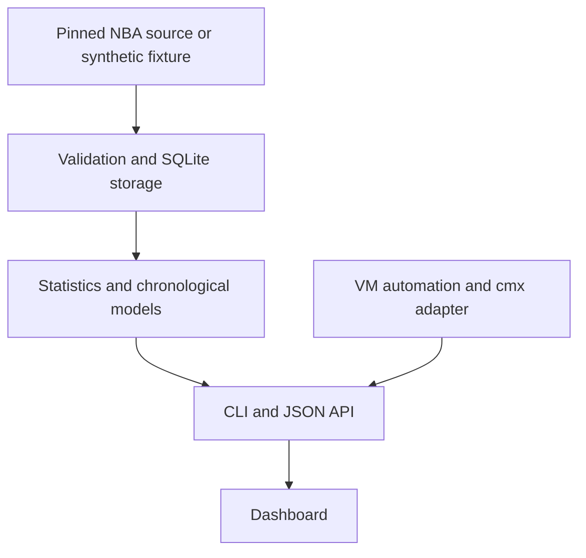

# Sports Statistics and Probability Analysis Platform

Sydel Ugwu · COMP 388 · Solo project · Midterm progress report · October 15, 2026

## Executive Summary

The Sports Statistics and Probability Analysis Platform provides a reproducible workflow for storing basketball observations, calculating historical threshold rates, and comparing probability forecasts. The application uses Python, SQLite, a command-line interface, a JSON API, and a dashboard. The dashboard makes trends and uncertainty easier to inspect; analysis and data management remain available without a graphical interface.

The current milestone adds permitted historical NBA team data to the earlier fictional player demonstration. A pinned FiveThirtyEight dataset supplies 2,460 team-game observations from the 2014–15 regular season, representing 1,230 games and 30 teams. A small online logistic model uses only earlier game results. In the selected Chicago experiment, the model's Brier score is 0.2533 across 72 evaluated games, compared with 0.2572 for a historical-rate baseline and 0.2500 for a constant 50% forecast. The model does not beat the constant forecast on this sample.

Automated Multipass deployment and service recovery have original Mac evidence from October 1. The updated application passes 34 tests in the preparation environment. Multipass, Chameleon KVM@TACC, and Google Compute Engine have defined roles and a concrete `cmx` command adapter. Live Chameleon and Google deployment, the updated application on the Mac, and today's required SSH-key checks remain unverified. These limits are part of the midterm status.

## Problem, Research Question, and Scope

Sports averages alone do not explain how often a points threshold was exceeded or whether a forecast improves on a simple baseline. The application preserves data provenance and exposes sample size, uncertainty, and chronological error.

**Research question:** For Chicago's 2014–15 regular season, does a logistic model using prior scoring history improve Brier error for the event `team points > 100.5`, compared with a smoothed historical rate and a constant 50% forecast on the same games?

The completed milestone covers team scoring, validated storage, reproducible import, historical summaries, model evaluation, CLI/API access, and a dashboard. The earlier synthetic dataset also exercises player and opponent filters. The historical source contains team totals, so aggregate records are explicitly labeled and are not presented as individual player statistics. Real player data, additional seasons, live feeds, and a larger cross-cloud experiment remain future work. Real-money betting and guaranteed predictions are outside the scope.

## Method and Architecture



The importer checks the source SHA-256 before conversion, selects the NBA regular season ending in 2015, and preserves both teams' views of each game. SQLite validation rejects duplicate observations and inconsistent scores. Existing data requires an explicit replacement flag. Raw CSV files, databases, credentials, and VM disks stay outside Git.

The historical frequency uses all 82 selected Chicago games. Its 95% Wilson interval describes sampling uncertainty under the binomial approximation; season dependence and selection bias limit that interpretation. It is not a confidence guarantee for an individual future game.

The logistic model has an intercept and two fixed-scale features: the prior five-game scoring mean minus the threshold, and the previous game's points minus the threshold, each divided by 20. Weights begin at zero. Learning starts after five earlier games, with learning rate 0.05. Evaluation starts after ten earlier games. Each date is predicted before its outcomes update the weights; same-day outcomes cannot enter same-day predictions. All three comparison scores use the same 72 evaluation games. Filters, threshold, and model settings were fixed before this reported experiment; the result is exploratory, not a tuned test of general NBA forecasting performance.

## Cloud Computing, DevOps, and AI

**Cloud computing:** The existing `sports.vm` automation creates a dedicated Ubuntu 24.04 Multipass VM, transfers source, runs guest tests, and configures a systemd service. SQLite remains on the guest disk. Native Multipass automation has observed evidence; the new three-provider `cmx` adapter has local contract tests, without a claim of live success on all providers.

**DevOps:** The repository contains Make targets, deterministic fixtures, transactional imports, unit and HTTP integration tests, service configuration, and versioned aggregate results. Focused commits separate data import, modeling, interfaces, cloud integration, and reporting. Deployment archives exclude data and symbolic links. Reproduction downloads the pinned source instead of putting raw data in Git.

**AI:** The application implements a small online logistic classifier using Python's standard library. Its predictions are tested against two baselines. No paid LLM API is called by the application. AI assistance in development and writing is disclosed separately in [AI usage](project/ai-usage.md).

### Three Clouds and Concrete `cmx vm` Integration

| Target | Project role | Implemented integration | Observed live evidence |
| --- | --- | --- | --- |
| Multipass | Local development and repeatable demo | Existing native deployment; new `cmx` plan and guest-analysis smoke command | October 1 synthetic app deployment and recovery; updated historical model through `cmx` still unverified |
| Chameleon KVM@TACC | OpenStack reproduction of the same source and dataset | `--cloud chameleon` plan and guest-analysis smoke command | Account, allocation, deployment, and smoke test unverified |
| Google Compute Engine | Short CPU evaluation on a public cloud | Upstream key `--cloud google`; plan and guest-analysis smoke command; focused driver-constructor patch | Billing, credentials, provisioning, and smoke test unverified |

The selection satisfies the required categories on paper. Instructor acceptance of the selection and actual three-cloud operation have not been established. Current integration targets upstream `dev2` at `f55d7bd`; Chameleon's native path also requires checking the instructor's current feature branch and smoke tests.

```bash
python3 -m sports.cloud plan --cloud multipass
python3 -m sports.cloud plan --cloud chameleon
python3 -m sports.cloud plan --cloud google
```

These commands only print a plan. Creation uses the current positional syntax `cmx vm --cloud google start sports-google`. It is not a safe resume command for an existing VM in the audited version. After source and the historical database have actually been installed in `~/sports-project` on a target, the adapter can validate a real guest analysis:

```bash
python3 -m sports.cloud smoke --cloud google --name sports-google
```

The smoke command checks for a JSON success sentinel, positive dataset rows, and evaluated games. A provider's error text or a zero process exit alone does not count as success. The adapter does not yet automate remote source/data deployment on Chameleon or Google. Credentials, quota, passphrase-protected SSH keys, and a working provider are prerequisites. No successful live three-cloud run is claimed.

## Results and Verification

| Chicago 2014–15 regular-season result | Value |
| --- | --- |
| Selected games | 82 |
| Games strictly above 100.5 points | 43 |
| Mean team points | 100.79 |
| Historical frequency | 52.44% |
| 95% Wilson interval | 41.76%–62.90% |
| Matched chronological evaluation games | 72 |
| Logistic Brier score | 0.2533 |
| Historical-rate Brier score | 0.2572 |
| Constant 50% Brier score | 0.2500 |

Brier score is mean squared probability error; lower is better. Logistic regression slightly improves on the historical-rate baseline here, but the constant forecast has the lowest error. One team, one season, and one threshold do not establish an advantage on other data. No improvement claim is made from the synthetic demonstration. The dashboard's original historical-only panel uses a five-game warmup; comparisons with the logistic model must use the separate matched-cohort model panel, not that older panel's 77-game score.

Evidence is separated by environment:

- [October 15 verification](project/evidence/oct15-verification.txt): 34 passing local unit/HTTP tests in the preparation environment, including leakage and interface checks. No real cloud account was used.
- [Aggregate experiment](project/evidence/nba2015-summary.json): exact unrounded metrics, selection, model settings, source revision, and checksum.
- [October 1 VM evidence](project/vm-deployment.md): original Mac screenshots showing 23 guest tests at that time, systemd health, stop/start, and a healthy service with 144 synthetic rows after restart. This does not prove that all database contents were byte-for-byte unchanged or that the updated model was deployed there.

## Reproduce the Current Application

From the repository root, using Python 3.12 or newer:

```bash
make -C sports test
make -C sports history
make -C sports model
make -C sports historical-serve
```

Open <http://127.0.0.1:8000>. The real-data dashboard initially selects Chicago and threshold 100.5. The import downloads approximately 18 MB into ignored `sports/data/`. Skip `history` when the historical database already exists; replacement requires an explicit decision. The synthetic demo uses a separate database. [Run instructions](sports/README.md) describe both paths.

## Class Contributions and Review Feedback

[Upstream PR #11](https://github.com/cloudmesh-ai/cloudmesh-ai-vm/pull/11) is closed and unmerged. It changed 23 files with 1,224 additions and 378 deletions. The instructor requested a current upstream base, preservation of existing tests, reuse of hostlist utilities, validation before submission, one provider per PR, separate documentation, and one PR at a time.

The prepared successor changes only Google driver initialization and its tests. It imports the actual Libcloud GCE driver, passes the documented constructor arguments, and fails early for missing configuration. Seven Google-focused tests pass without contacting Google, including four new constructor checks. The four-file patch has 63 additions and 18 deletions. Two existing test files receive only Google fixture/assertion updates; existing coverage remains. A wider 22-test run has one AWS unsupported-method failure that also reproduces on unmodified dev2. It does not claim to fix Google's full lifecycle. No new upstream PR has been published. The intended base is current `dev2`; it must be refreshed and revalidated before submission. Documentation is a later, separate change. [Contribution details](project/contributions.md) map each instructor request to the follow-up work.

## Issues and Remaining Work

1. Formal sports-project approval and acceptance of the three selected clouds are not documented in the reviewed evidence. These require instructor confirmation.
2. Live Chameleon and Google deployment, remote data setup, and matched result reproduction remain incomplete. Current upstream provider/CLI behavior also needs validation on the instructor's latest branches.
3. The updated application and 34-test suite have not been verified on the Mac or sports VM. October 1 evidence refers to the earlier 23-test application.
4. Today's required `cmx key scan` and `cmx key github list` must be run on the actual Mac. Passphrases and ssh-agent/Keychain use have not been verified here. Sensitive key-scan output must not be added to the public repository.
5. The GitHub integration returned a write-permission error. Prepared edits and the small upstream patch are local until applied and pushed with working access.
6. The real-data source has team totals through 2015. Real player observations, broader seasons, calibration checks, and independent evaluation remain open.

The next milestones are to review the new code and explanations, verify the updated local demo, complete the key checks, resolve cloud account/provider prerequisites, and reproduce the same evaluation on both remote clouds. The instructor review should distinguish current evidence from these open items.

## Cost, Security, and AI Acknowledgment

The application needs no paid data service or hosted LLM. Multipass uses local resources. Chameleon use depends on an eligible allocation. Google requires a verified billing setup, budget alerts, short runtimes, and removal of idle resources. Credits are not assumed to be active. Exact services, a worked cost estimate, and free/open-source alternatives appear in the [cost appendix](project/costs.md).

OpenAI Codex provided substantial assistance with source review, implementation, tests, experiment execution, documentation, and presentation drafting. The sports project topic predates this assistance. The exact underlying model identifier was not exposed in the tool session. AI assistance is not evidence of independent student authorship, understanding, instructor approval, or live cloud validation. The student must review the work and explain its behavior before presenting it. [AI usage](project/ai-usage.md) records scope, examples, useful contributions, failures, and verification boundaries.

## References

- [Week 7 assignment and presentation requirements](https://cloudmesh-ai.github.io/cloudmesh-ai-lecture/lecture/assignments/assignments/) and [project requirements](https://cloudmesh-ai.github.io/cloudmesh-ai-lecture/lecture/assignments/overview/).
- Piazza: [AI-use presentation #111](https://piazza.com/class/mt5rkdsycb31c3/post/111), [existing project and LLMs #88](https://piazza.com/class/mt5rkdsycb31c3/post/88), [acknowledgment #100](https://piazza.com/class/mt5rkdsycb31c3/post/100), [cost appendix #101](https://piazza.com/class/mt5rkdsycb31c3/post/101), [report format #102](https://piazza.com/class/mt5rkdsycb31c3/post/102), [third person #49](https://piazza.com/class/mt5rkdsycb31c3/post/49), and [SSH checks #124](https://piazza.com/class/mt5rkdsycb31c3/post/124).
- FiveThirtyEight, [Historical NBA Elo source description](https://github.com/fivethirtyeight/data/tree/master/nba-elo) and [explicit CC BY 4.0 data license](https://github.com/fivethirtyeight/data#license). Original game information is attributed there to Basketball-Reference. Conversion keeps regular-season team totals; no Elo forecast is reused.
